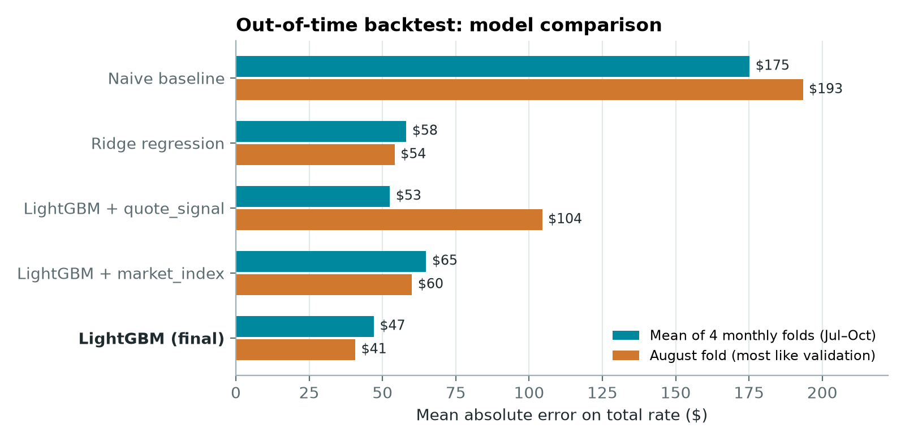
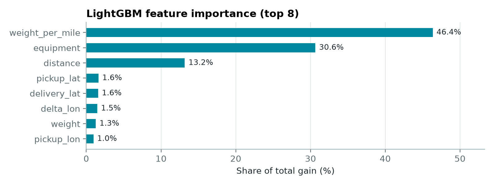

# Freight Rate Prediction

Predicting the posted rate (in $) for truckload freight loads from historical load data.
The final model is a **LightGBM** regressor that predicts **rate per mile** and multiplies by distance.

On an out-of-time backtest over four held-out months (July–October 2025) it reaches
**MAE $47.08 / MAPE 1.99%**, and **$40.74 on August** — the month whose feature behaviour matches the
November–December prediction window. A naive baseline scores $175 and Ridge regression $58.

Full write-up: [`reports/Freight_Rate_Report.pdf`](reports/Freight_Rate_Report.pdf)

## Results

| Model | Jul | Aug | Sep | Oct | Mean MAE | Mean MAPE |
|---|---|---|---|---|---|---|
| Naive: equipment median $/mile × distance | $156.74 | $193.42 | $177.84 | $172.98 | $175.25 | 8.04% |
| Ridge regression | $70.71 | $54.18 | $56.80 | $50.89 | $58.14 | 2.75% |
| LightGBM + quote_signal | $44.01 | $104.48 | $28.27 | $33.46 | $52.55 | 2.32% |
| LightGBM + market_index | $41.69 | $60.09 | $89.58 | $68.29 | $64.91 | 2.97% |
| **LightGBM (final)** | **$64.27** | **$40.74** | **$43.92** | **$39.40** | **$47.08** | **1.99%** |



## Approach

### Validation design

Training data covers January–October; the prediction targets are November–December. Validation is
therefore **out-of-time with an expanding window**: train on all months before July, August, September
and October in turn, and test on that month. Random K-fold would leak future information into
training and — critically — would have hidden the `quote_signal` problem below.

### The leaking feature

`quote_signal` is the single strongest predictor by correlation and the worst feature in the set.

- It **equals** the true rate per mile in Jan/Feb/Mar/Jun/Sep (corr **+0.996**)
- It **mirrors** it in Apr/May/Jul/Oct (corr **−0.99**)
- It is **noise** in August

The unlabelled target months carry August's signature, not the leak's: `quote_signal` correlates ~0
with distance there, versus ±0.7 in every other month. Including it produces $28–$33 MAE in the leak
months and **$104 on August — 2.6× worse than the final model**. It scores better on average and
would fail on the period that actually matters, so it is excluded.

`market_index` is also excluded: it swings from 0.89 to 1.30 across the year while rate per mile
barely moves, and it is worse on average. Smoothed variants did not help.

### Data quality

- **Label errors:** 677 training rows (1.4%) sit far from the normal rate per mile, in two clusters at
  roughly 0.3× and 3.5×. Rows outside $1.30–$4.00 per mile are dropped from training.
- **Negative weights** (292 train, 145 validation): the range is symmetric at ±47,500, so these are
  sign errors. Absolute value corrects them, with a flag column recording the change.
- **Missing values:** weight filled with the training median, market_index with that day's mean, each
  with a missing-value indicator.
- **Unseen cities:** 8 validation cities never appear in training, so the model keys on lat/lon rather
  than city names and handles new locations.

### Model

LightGBM on rate per mile with **Huber loss** (robust to residual label noise), weighted by distance so
the loss tracks dollar error rather than per-mile error. Refit on all January–October data using the
averaged early-stopping round count.



### Other tree models

The final setup was also run with XGBoost, CatBoost and Random Forest: same features, target, distance
weighting, folds and early stopping (`python src/compare_models.py`). Mean MAE over the four folds:

| Model | Mean MAE | Mean MAPE | Aug MAE | Fit time per fold |
|---|---|---|---|---|
| **LightGBM (final)** | **$47.08** | **1.99%** | $40.74 | **1.1s** |
| CatBoost | $47.02 | 1.96% | $40.39 | 49s |
| XGBoost | $47.29 | 2.01% | $41.11 | 3.3s |
| Random Forest | $51.09 | 2.16% | $45.83 | 4.8s |

- **The three boosting libraries tie.** The gaps are under $0.30, which is noise. The gains come from
  the cleaning, the validation design and the feature choices, not from the library.
- **LightGBM is kept** because it is tied on accuracy, 3× faster than XGBoost, 45× faster than CatBoost,
  and its Huber loss trains reliably. XGBoost's pseudo-Huber loss collapsed to a constant prediction
  and CatBoost's Huber loss did not converge, so both are scored here with squared error.
- **Random Forest is about $4 worse on every fold.** It averages independent trees, while boosting fits
  each new tree to the remaining error.

### Follow-up experiments

A second round tested whether simple additions could improve on the final model. Each variant was
scored on the same July–October folds with a fixed 440 trees, and again with a one-month gap between
training and test, which mimics predicting December from data that ends in October. Values are mean
MAE over the four folds.

| Variant | Next month | One-month gap |
|---|---|---|
| **Final model (fixed 440 trees)** | **$47.13** | **$50.91** |
| Drop `weight_per_mile` | $47.11 | $51.03 |
| Add pickup / delivery city as categorical features | $47.22 | $51.12 |
| Blend 75% LightGBM + 25% Ridge | $47.72 | $51.38 |
| Blend 50% LightGBM + 50% Ridge | $49.95 | $53.46 |
| Recency weighting, 120-day decay | $47.91 | $51.89 |
| Recency weighting, 60-day decay | $51.96 | $57.43 |
| Level multiplier: last 60 days' level + `market_index` | $49.68 | $51.01 |
| Level multiplier: `market_index` only | $66.06 | $77.19 |
| Level multiplier: `market_index` + quarter-end + trend | $52.34 | $80.72 |
| Quarter-end progress as a LightGBM feature | $59.29 | $60.10 |

- **Nothing beats the final model.** The closest variants tie it within $0.25 and the rest are worse.
  Corrections that help one month hurt another: the `market_index` multiplier takes July from $64 to
  $45 but September from $44 to $105.
- **Little is left to gain.** If each day's overall price level were known exactly, MAE would still be
  about $35.50, because the rest is load-level noise. The model already scores $39–41 in August and
  October.
- **The link between `market_index` and the price level is unstable.** Its fitted strength ranges from
  0.03 to 0.18 depending on the training months and the other terms in the fit, so no multiplier built
  on it holds up out of time.
- **Quarter-end months ramp up.** The price level rises about 3–5% through March, June and September
  and then falls back, most strongly for Flatbed. December is also a quarter-end, so the same may
  happen there. Every way of using the pattern made the backtest worse, including on September itself
  ($45–73 against $44), because the ramp cannot be separated from each month's different base level.
  It is not modelled.
- **`weight_per_mile` and city names add no information.** Dropping `weight_per_mile` leaves the error
  unchanged ($47.11), so the model recovers it from weight and distance. City categories add nothing
  beyond lat/lon.

## Running it

Requires Python 3.11+.

```bash
python -m venv venv
source venv/bin/activate          # Windows: venv\Scripts\activate
python -m pip install -r requirements.txt

python src/eda.py                 # data audit + charts in reports/figures/
python src/train.py               # backtest, model comparison, saves models/freight_model.pkl
python src/predict.py             # writes predictions
python src/report_figures.py      # rebuilds report charts
python -m pytest -q               # sanity tests for cleaning and output format

# optional: compare against XGBoost / CatBoost / Random Forest (extras not in requirements.txt)
python -m pip install xgboost catboost
python src/compare_models.py      # about 5 minutes, mostly CatBoost
```

The pipeline is deterministic (`random_state=42`) and runs end to end in under a minute.

> **Note:** the source datasets are not included in this repository. Place `train-test.csv`,
> `validation.csv`, `validation-predictions-template.csv` and `december-chart-inputs.csv` in `data/`
> to run the pipeline. The final `validation_predictions.csv` and the December chart
> (`scorer_results/candidate_december.png`) are included.

## Structure

```
├── src/
│   ├── eda.py             # data-quality audit, target analysis, drift checks, figures
│   ├── preprocess.py      # loading, cleaning, feature engineering (shared by train and predict)
│   ├── train.py           # out-of-time backtest, baselines, ablation, final refit
│   ├── compare_models.py  # optional: XGBoost / CatBoost / Random Forest on the same folds
│   ├── predict.py         # inference and prediction files
│   └── report_figures.py  # charts used in the written report
├── reports/
│   ├── figures/           # EDA and report charts
│   ├── metrics.json       # backtest metrics and feature importance
│   └── Freight_Rate_Report.pdf
├── tests/                 # pytest sanity tests
└── requirements.txt
```